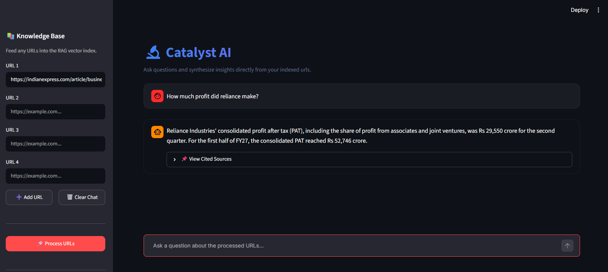

# Research Assist AI

A Streamlit-based Retrieval-Augmented Generation (RAG) application that transforms public web pages into a searchable knowledge base. Ingest URLs, index their content, and ask questions using retrieved document context, with source references to help verify the answers.

Live Link: https://research-assist-ai.streamlit.app/



## ✨ Features

- **Web Content Ingestion:** Load content from multiple public URLs using LangChain's `WebBaseLoader`.
- **Document Processing:** Split documents into manageable chunks using `RecursiveCharacterTextSplitter`.
- **Semantic Embeddings:** Generate document embeddings using LangChain's `HuggingFaceEmbeddings` integration.
- **Vector Database:** Store and retrieve document embeddings using Chroma.
- **Retrieval-Augmented Generation:** Use LangChain's `RetrievalQAWithSourcesChain` to combine relevant document retrieval with LLM-powered answer generation.
- **LLM Integration:** Generate responses using Groq-hosted language models through LangChain's `ChatGroq` integration.
- **Source Attribution:** Display source URLs associated with retrieved information.
- **Persistent Storage:** Preserve indexed documents in a local Chroma vector database.
- **Interactive Chat Interface:** Explore indexed web content through a Streamlit application with ingestion and query status indicators.

## 🏗️ Architecture

The application uses LangChain to connect the document ingestion, embedding, retrieval, and answer-generation components.

```text
                 Public Web URLs
                        │
                        ▼
                  WebBaseLoader
                        │
                        ▼
           RecursiveCharacterTextSplitter
                        │
                        ▼
               HuggingFaceEmbeddings
                        │
                        ▼
                Chroma Vector Store
                 (Persistent Storage)
                        │
                        ▼
                     Retriever
                        │
                        ▼
             RetrievalQAWithSourcesChain
                        │
                        ▼
                    ChatGroq
                        │
                        ▼
               Generated Answer
                        │
                        ▼
                  Source URLs
```

### How the RAG Pipeline Works

1. **Ingestion:** Load content from user-provided URLs.
2. **Chunking:** Divide the extracted content into smaller text chunks.
3. **Embedding:** Convert document chunks into vector embeddings using a Hugging Face embedding model.
4. **Indexing:** Store the embeddings and associated documents in Chroma.
5. **Retrieval:** Find relevant document chunks for a user's question.
6. **Generation:** Pass the retrieved context to a Groq-hosted language model through LangChain.
7. **Source Attribution:** Return the generated answer alongside source references.

## 🛠️ Tech Stack

| Component | Technology |
|---|---|
| Programming Language | Python |
| Frontend | Streamlit |
| RAG Framework | LangChain |
| Retrieval Chain | `RetrievalQAWithSourcesChain` |
| URL Loader | `WebBaseLoader` |
| Text Splitter | `RecursiveCharacterTextSplitter` |
| Embedding Integration | `HuggingFaceEmbeddings` |
| Embedding Models | Hugging Face |
| Vector Database | Chroma |
| Vector Store Integration | `langchain-chroma` |
| LLM Integration | `ChatGroq` |
| LLM Provider | Groq |
| Configuration Management | `python-dotenv` |

The project uses modular LangChain integrations for document loading, text splitting, embeddings, vector storage, and LLM interaction.

## 📋 Prerequisites

Before running the application, ensure you have:

- Python 3.10 or newer.
- A [Groq API key](https://console.groq.com/keys).
- Internet access to retrieve web content and download the embedding model when required.
- The dependencies listed in `requirements.txt`.

## 🚀 Installation

### 1. Clone the Repository

Replace the placeholders with your repository URL and directory name.

```bash
git clone <your-repository-url>
cd <repository-directory>
```

### 2. Create a Virtual Environment

**Windows — PowerShell**

```powershell
python -m venv .venv
.\.venv\Scripts\Activate.ps1
```

**macOS / Linux**

```bash
python -m venv .venv
source .venv/bin/activate
```

### 3. Install Dependencies

Upgrade pip and install the project dependencies.

```bash
python -m pip install --upgrade pip
pip install -r requirements.txt
```

### 4. Configure Environment Variables

Create a `.env` file in the project root directory.

```env
GROQ_API_KEY=your_groq_api_key
GROQ_MODEL=your_available_groq_model
EMBEDDING_MODEL=your_hugging_face_embedding_model
COLLECTION_NAME=research_store
```

Configure each variable according to the models and settings supported by your implementation.

**Security:** Never commit your `.env` file or expose API keys in your repository. Add `.env` to `.gitignore`.

### 5. Run the Application

Launch the Streamlit application:

```bash
streamlit run main.py
```

Streamlit will display a local URL in the terminal. Open it in your browser, typically at:

```text
http://localhost:8501
```

## 💬 Usage

1. Launch the application.
2. Enter one or more public web URLs in the sidebar.
3. Click **Process URLs** to load, split, embed, and index the content.
4. Wait for processing to complete.
5. Ask questions about the indexed documents through the chat interface.
6. Expand **View Cited Sources** below an answer to inspect the associated source URLs.

### Example Questions

- What are the main findings in these articles?
- Summarize the key points from the provided sources.
- Compare the recommendations across these documents.
- What evidence supports the main conclusion?
- Identify the major differences between the indexed articles.

The quality of the answers depends on source accessibility, document processing, retrieval relevance, and the selected language model.

## 📁 Project Structure

```text
.
├── main.py                  # Streamlit user interface
├── rag.py                   # RAG pipeline and answer generation
├── requirements.txt         # Python dependencies
└── resources/
    ├── ui.png               # Application screenshot
    └── vectorstore/         # Persistent Chroma database
```

The directory structure above reflects the project layout described in this README. Update it if your repository differs.

## ⚙️ Configuration Reference

| Variable | Description |
|---|---|
| `GROQ_API_KEY` | API key used to authenticate requests to Groq. |
| `GROQ_MODEL` | Groq-hosted language model used to generate answers. |
| `EMBEDDING_MODEL` | Hugging Face embedding model used for semantic search. |
| `COLLECTION_NAME` | Name of the Chroma collection used to store indexed documents. |

The Chroma vector database is persisted under `resources/vectorstore`, allowing previously indexed content to remain available between application launches.

## 🔒 Security and Limitations

- **API key security:** Store credentials in environment variables and never commit secrets to version control.
- **Website accessibility:** Some websites restrict automated requests or require JavaScript rendering, which may prevent successful ingestion.
- **Source quality:** Incomplete or inaccurate source content can affect the quality of generated answers.
- **Retrieval limitations:** Relevant information may not always be retrieved for every question.
- **LLM limitations:** Generated responses may contain unsupported claims. Review the cited sources when accuracy matters.
- **Internet dependency:** URL ingestion and Groq-hosted inference require network connectivity.

Only process web content that you are authorized to access and use, and respect applicable website terms and copyright requirements.

## 🔮 Potential Future Improvements

The following are potential enhancements rather than claims about existing functionality:

- Add automated tests for document ingestion, retrieval, and answer generation.
- Implement URL validation, duplicate detection, and improved error handling.
- Evaluate retrieval quality using a dedicated RAG evaluation framework.
- Add configurable chunk sizes, overlap settings, and retrieval parameters.
- Introduce document metadata filtering and more advanced retrieval strategies.
- Add Docker support for reproducible deployment.
- Implement CI workflows for automated testing and code quality checks.

## 📄 License

This project is distributed under the MIT License, as referenced by the repository's `LICENSE` file.